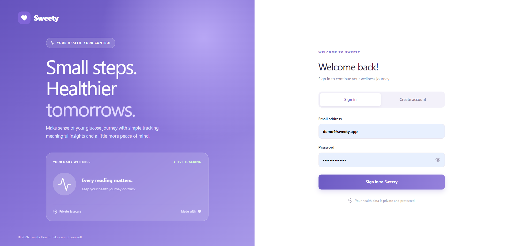
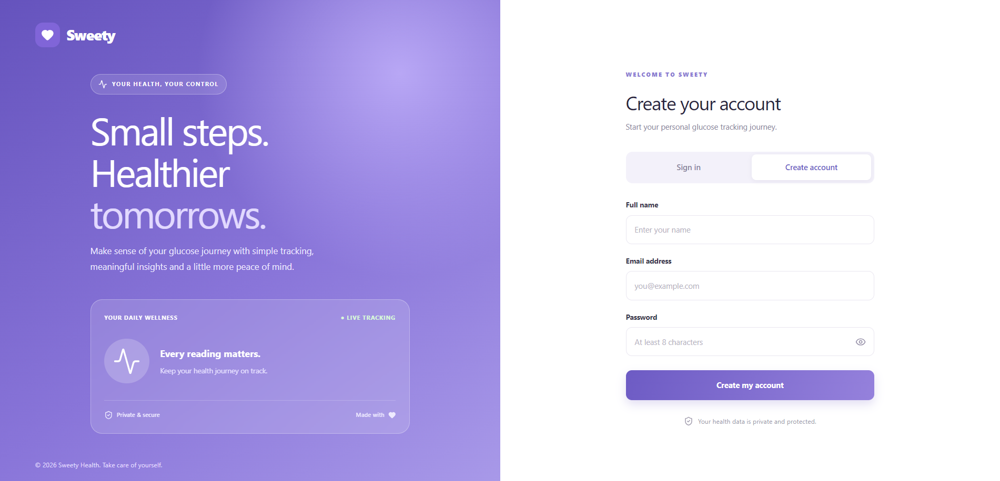
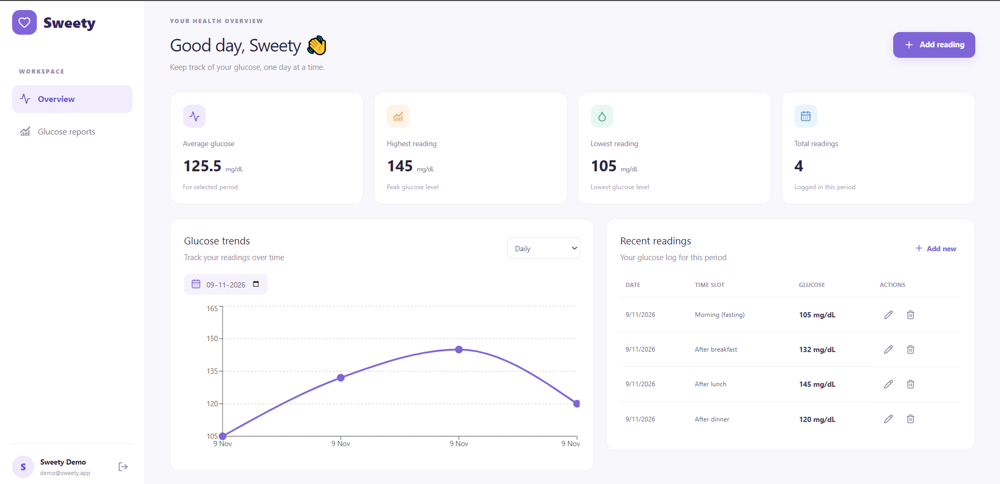
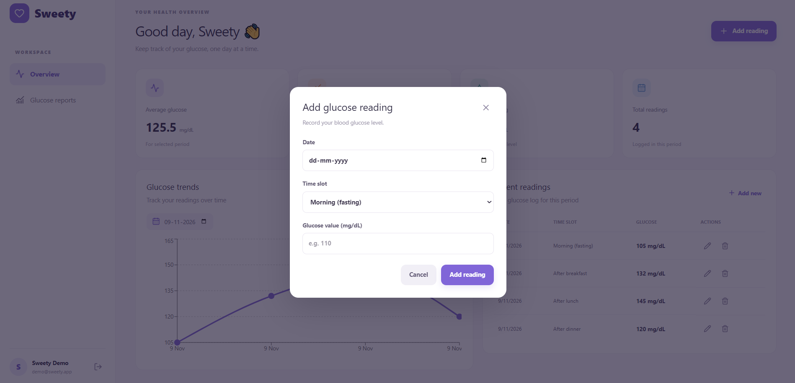
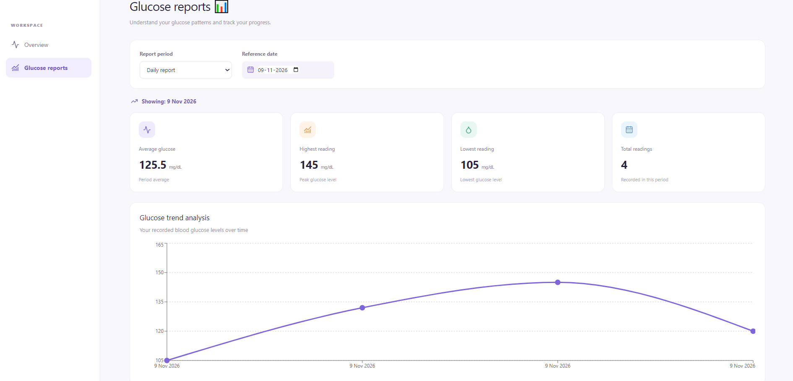
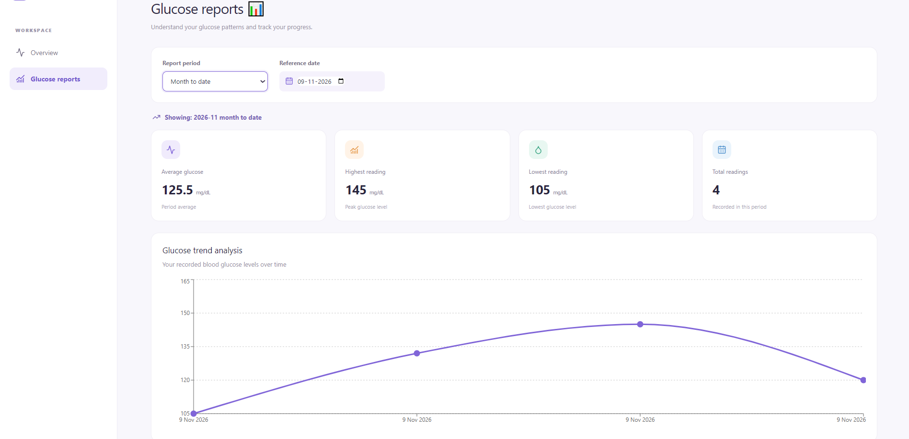
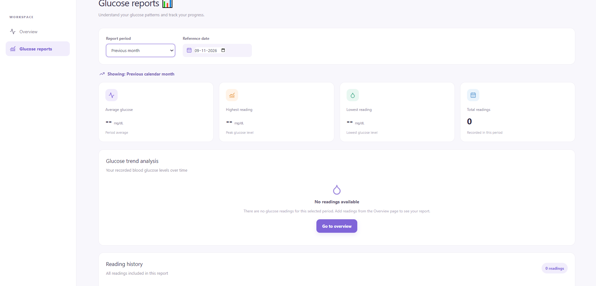

# Sweety – Blood Glucose Tracker

A full-stack blood glucose tracking application built with React, TypeScript, Node.js, Express, PostgreSQL and Prisma.

## Features

- Secure user registration and login.
- JWT authentication and bcrypt password hashing.
- Create, view, update and delete glucose readings.
- Four daily reading slots.
- Glucose validation between 40 and 600 mg/dl.
- Prevention of duplicate readings.
- Daily and monthly reports.
- Highest, lowest and average glucose statistics.
- Responsive dashboard with trend charts.

## Application Screenshots

### Authentication

### Dashboard and Reading Management

### Glucose Reports

## Technology Stack

- React, TypeScript, Vite and Tailwind CSS.
- Node.js and Express.
- PostgreSQL and Prisma ORM.
- JWT, bcryptjs and Zod.
- Recharts and Vitest.

## Project Structure

- client/: React frontend.
- server/: Express API and Prisma database.
- screenshots/: Application screenshots.
- work.md: Development progress log.

## Prerequisites

- Node.js 20 or later.
- npm.
- PostgreSQL 14 or later.
- Git.

## Installation

1. Clone the repository:

   `git clone https://github.com/Surya189-ops/sweety-blood-glucose-tracker.git`

   `cd sweety`
2. Create a PostgreSQL database named sweety_db.
3. Configure the backend environment variables.
4. Run database migrations.
5. Seed demo data.
6. Start the backend and frontend.

### Backend setup

From the project root:

1. Enter the server directory: `cd server`
2. Install dependencies: `npm install`
3. Copy the environment example: `cp .env.example .env`
4. Edit `.env` with your PostgreSQL connection and JWT secret.

Required environment variables:

- DATABASE_URL
- JWT_SECRET
- PORT
- CLIENT_URL
- NODE_ENV

Generate Prisma Client:

`npm run db:generate`

Apply database migrations:

`npm run db:migrate`

Create demo data:

`npm run db:seed`

Start the backend:

`npm run dev`

The API runs on port 5000.

### Frontend setup

Open a second terminal from the project root.

1. Enter the frontend directory: `cd client`
2. Install dependencies: `npm install`
3. Copy the environment example: `cp .env.example .env`
4. Start the frontend: `npm run dev`

The Vite development server normally runs on port 5173.

The frontend development proxy forwards `/backend` requests to the Express API.

## Demo Account

Use the following credentials to explore the seeded demo account:

- Email: `demo@sweety.app`
- Password: `SweetyDemo123!`

These credentials are for demonstration only. Do not use them for real health information.

Running the seed command again resets the demo account's sample readings.

## API Endpoints

All endpoints use the `/api` prefix.

### Authentication

| Method | Endpoint | Description |
|---|---|---|
| POST | `/api/auth/register` | Register a user |
| POST | `/api/auth/login` | Log in |
| GET | `/api/auth/me` | Get current user |

### Glucose Readings

All reading endpoints require authentication.

| Method | Endpoint | Description |
|---|---|---|
| GET | `/api/readings` | List user readings |
| POST | `/api/readings` | Add a reading |
| PUT | `/api/readings/:id` | Update a reading |
| DELETE | `/api/readings/:id` | Delete a reading |

### Reports

All report endpoints require authentication and a date in YYYY-MM-DD format.

- `GET /api/reports/daily?date=YYYY-MM-DD`
- `GET /api/reports/month-to-date?date=YYYY-MM-DD`
- `GET /api/reports/monthly?date=YYYY-MM-DD`

The reports include highest, lowest, average and total readings.

Report periods:
- **Daily:** Readings for the selected date.
- **Month-to-date:** Readings from the first day of the selected month through the selected date.
- **Monthly:** Readings for the complete calendar month immediately before the selected date's month.

### Health Check

`GET /api/health`

## Validation Rules

- Glucose values must be whole numbers between 40 and 600 mg/dl.
- Dates must be valid and cannot be in the future.
- Only one reading is allowed per slot per day.
- Maximum four readings per user per day.
- Duplicate email registrations are rejected.
- Users can access only their own readings.

## Testing

Run backend validation tests:

`cd server && npm test`

Build the backend:

`cd server && npm run build`

Build the frontend:

`cd client && npm run build`

## Security and Privacy

- Passwords are hashed using bcrypt.
- Protected endpoints require JWT authentication.
- Database queries are scoped to the authenticated user.
- Environment files containing secrets are excluded from Git.
- Demo credentials are intended for demonstration only.

Sweety is a tracking application, not a substitute for professional medical advice or diagnosis.

## Future Improvements

- Pagination for large reading histories.
- Expanded API integration and frontend tests.
- Docker-based deployment.
- Optional doctor/caregiver access with explicit user consent.
- Additional reporting and accessibility improvements.

---

Developed for the Kenpath Junior Full Stack Developer – JavaScript & AI assignment.
